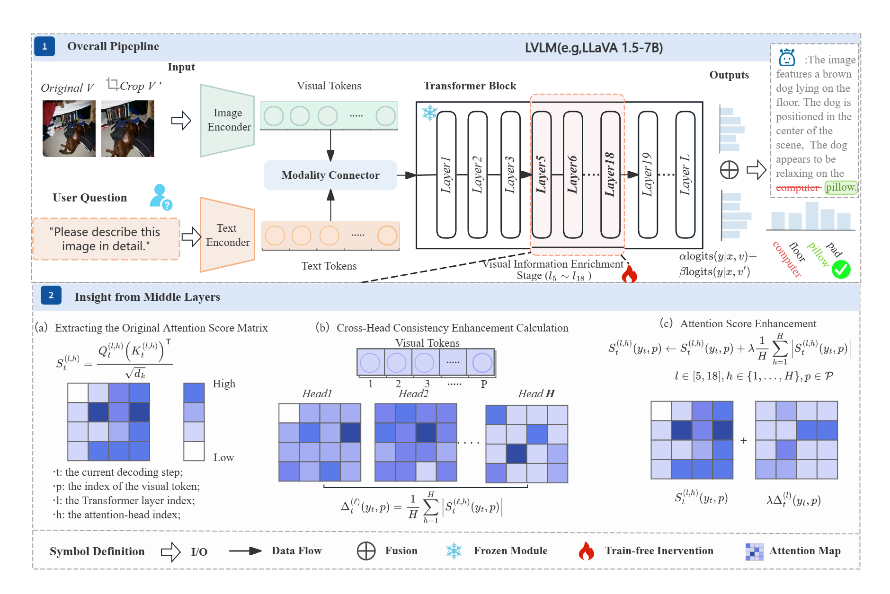
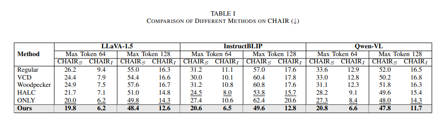
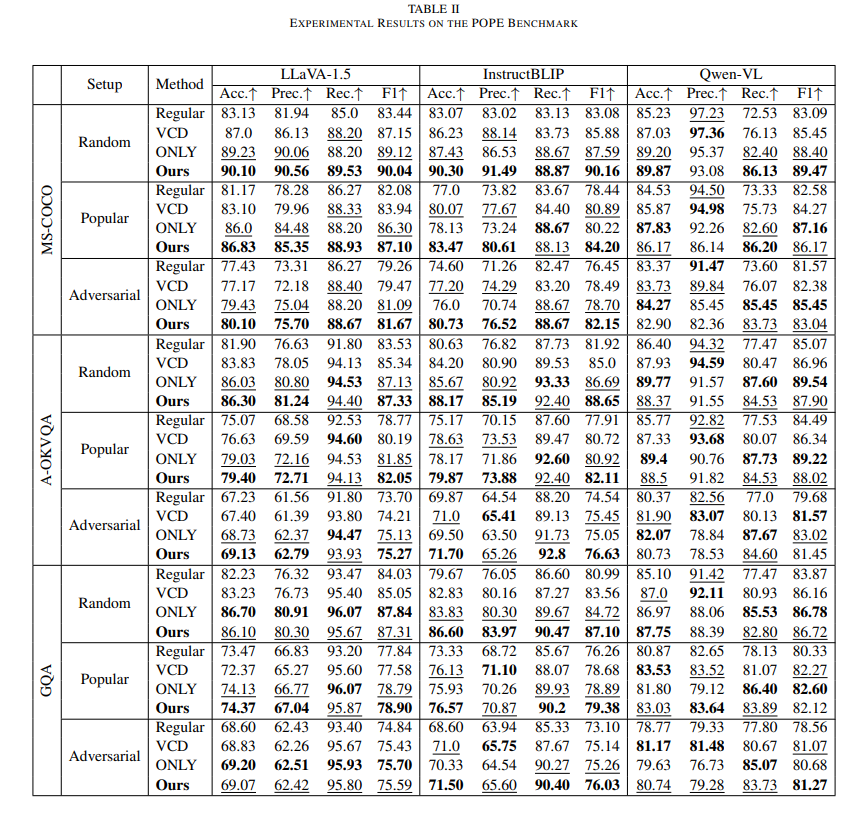
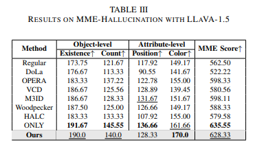
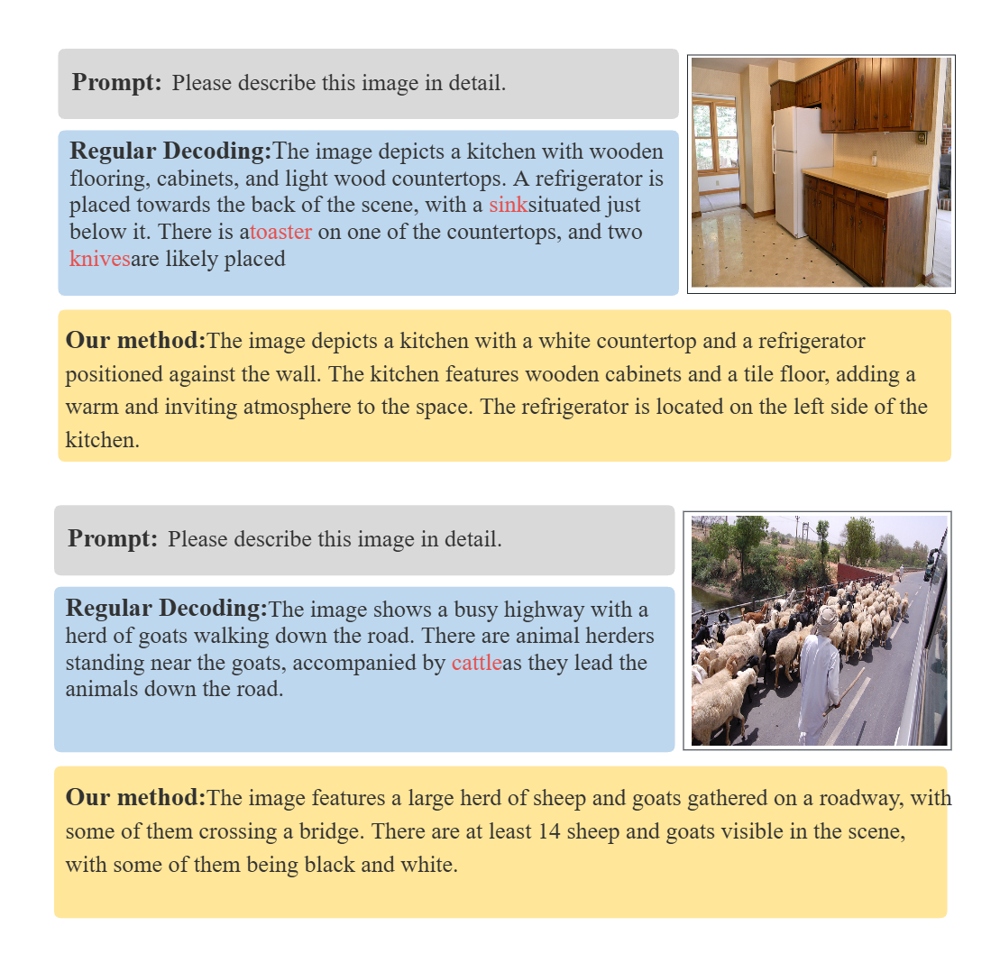

#  GLAM: Global-Local Fusion Decoding with Intermediate-Layer Attention Enhancement for Hallucination Mitigation in LVLMs


## 🚨 Updates
 * **2026.11.18**: GLAM 

## 👀 Overview
<p align="center" width="100%">

</p>


## 💻 Setup

```bash
conda create -n GLAM python=3.10
conda activate GLAM
git clone https://github.com/vitaminVit/GLAM.git
cd GLAM
pip install -r requirements.txt
```


## Models
* [**LLaVA-1.5**](https://github.com/haotian-liu/LLaVA): Download [LLaVA-1.5 merged 7B](https://huggingface.co/liuhaotian/llava-v1.5-7b)
* [**InstructBLIP**](https://github.com/salesforce/LAVIS/tree/main/projects/instructblip): Download [InstructBLIP](https://huggingface.co/Salesforce/instructblip-vicuna-7b)


## 📊 Evaluation

* **POPE**: `bash eval_bench/scripts/pope_eval.sh` 
  - Need to specify "model", "model_path"
* **CHAIR**: `bash eval_bench/scripts/chair_eval.sh`
  - Need to specify "model", "model_path", "type"
* **MME**: `bash experiments/cd_scripts/mme_eval.sh`
  - Need to specify "model", "model_path"

*About datasets preparation*
- Please download and extract the MSCOCO 2014 dataset from [this link](https://cocodataset.org/) to your data path for evaluation.


## Results
### CHAIR
<p align="center" width="100%">

</p>

### POPE
<p align="center" width="100%">

</p>


**MME-Hallucination**
<p align="center" width="100%">

</p>


<p align="center" width="100%">

</p>


